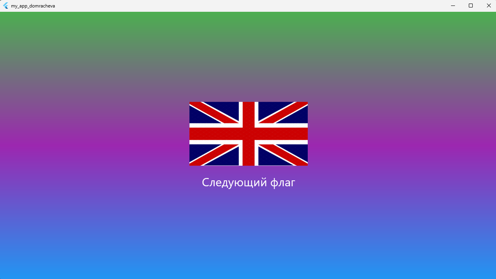

# Лабораторная работа №6: Flutter — приложение "Угадай флаг"
Приложение показывает флаг страны. По нажатию кнопки «Следующий» появляется следующий флаг из списка (по кругу).

**Автор: Домрачева Полина** 
**Группа: ИСП-241**
**Дата сдачи: 16.10.2026**

# Стек и версии
- Flutter 3.47.4 
- Dart 3.13.3 
- Платформа: Web (Chrome)
- IDE: VS Code

# Скриншот приложения

# Структура проекта
- `lib/main.dart` — точка входа, MaterialApp
- `lib/gradient.dart` — StatelessWidget с градиентом
- `lib/flag.dart` — StatefulWidget со случайной сменой флага

# Как запустить

git clone https://github.com/chipollina/-Flutter_Lab5.git

cd my_app_domracheva

flutter pub get

flutter run -d chrome

# Что изучила
1.Разбивка UI на отдельные виджеты-классы.

2.Передача данных через параметры конструктора.

3.Управление состоянием через StatefulWidget и setState().

4.Работа с Random для случайного выбора.

5.Подключение изображений через assets и pubspec.yaml.

